# Adaptive Performance State Machine & Camera Equations

Technical reference for [`src/hooks/usePerformanceAdaptation.ts`](../../../../src/hooks/usePerformanceAdaptation.ts), [`src/utils/dpr.ts`](../../../../src/utils/dpr.ts), [`src/constants/fractals.ts`](../../../../src/constants/fractals.ts), [`src/hooks/useFractalInteraction.ts`](../../../../src/hooks/useFractalInteraction.ts), [`src/components/FractalCanvas.tsx`](../../../../src/components/FractalCanvas.tsx), [`src/components/DebugPanel.tsx`](../../../../src/components/DebugPanel.tsx), and [`src/App.tsx`](../../../../src/App.tsx).

---

## 1. Frame-Loop & Quality State Machine

```mermaid
stateDiagram-v2
  [*] --> Interacting : pointer/wheel/slider active
  Interacting --> Settling : input released\n(inherits int eps & iters; settledResScale = 1.0)
  Interacting --> Interacting : 30 FPS (33.3ms) EMA target\n4-tier cascade (DPR -> steps -> eps -> iters)
  Settling --> Interacting : new input or slider drag
  Settling --> Settling : 5 FPS (200ms) EMA target\n150ms DPR step-up; sqrt(mult) refinement
  Settling --> Locked : !isInteracting & !isMoving\nsettleTime >= 1.0 &\n(updated==false || delta>=0.2s)
  Locked --> Settling : resize > 5px / param or slicer change /\nfractal switch / debug edit
  Locked --> Interacting : user pointer or wheel input
```



---

## 2. EMA, 4-Tier Cascade & DPR Budgeting (`usePerformanceAdaptation.ts` & `dpr.ts`)

- **Asymmetric EMA**:
  - `baseWindowSize = isInteracting ? 30 : 15`
  - `effectiveWindowSize = delta > smoothedDelta ? max(2, baseWindowSize / 3) : baseWindowSize` (reacts ~3x faster to frame drops than speedups)
  - `alpha = 1 / min(sampleCount, effectiveWindowSize)`
  - **Lag-spike fast path**: if `delta > smoothedDelta * 1.5 && delta > 0.1`, force `alpha = 0.9`.
- **Update cadence & hysteresis**:
  - Throttled to `>= 66ms` (`~15 Hz`), requires `sampleCount >= 3` (unless `!isInteracting && delta > 0.1`).
  - Target frame time: `33.33ms` (interactive, 30 FPS) vs `200ms` (settled, 5 FPS).
  - Deadband: `|error| < targetFrameTime * 0.15` returns `false` (converged).
- **Interactive 4-Tier Non-Destructive Cascade (multiplicative spillover on lag)**:
  1. **Tier 1 — Dynamic Resolution Scaling (`interactiveResolutionScale` -> `DPR`)**: Pure helpers `getDprBounds` and `calculateTargetDpr` in [`src/utils/dpr.ts`](../../../../src/utils/dpr.ts) (re-exported by `FractalCanvas.tsx`; kept separate so `App.tsx` can import `getDprBounds` without breaking `App.test.tsx`'s `FractalCanvas` mock). Drops internal DPR first (`1.5x -> 1.25x -> 1.0x` on high-DPI mobile; down to `0.75x` interactive floor on large `>= 750k` CSS-pixel tablet/desktop viewports), quantized to `0.25x` increments to avoid WebGPU swapchain thrashing — giving quadratic $O(\text{DPR}^2)$ fragment savings with zero fractal shape change.
  2. **Tier 2 — Grazing-Ray Step Cap (`interactiveSteps`)**: Adapts dynamically within `[config.minInteractiveSteps, config.interactiveSteps]` so runaway silhouette grazing rays and deep dark crevices bail early while front-facing surfaces stay crisp.
  3. **Tier 3 — Pixel-Bounded Surface Threshold (`interactiveEpsilon`)**: `maxInteractiveEpsilon` is tightened to `0.0015–0.002` across `FRACTAL_CONFIGS` (~1.5–2px cone max instead of `0.004–0.008`) so thin tendrils never bloat into "melted clay" blobs.
  4. **Tier 4 — Emergency Survival Floor (`interactiveIterations`)**: Remains **locked** at `defaultInteractiveIterations` (+ zoom-LOD boost in `App.tsx`) during normal interaction so 3D topology and orbit-trap colors never pop mid-drag; only drops toward `minInteractiveIterations` if Tiers 1–3 are exhausted and FPS still lags.
- **Exact Reverse-Order Interactive Recovery (on fast frames)**:
  1. `interactiveIterations -> config.defaultInteractiveIterations` (never exceeds default automatically)
  2. `interactiveEpsilon -> config.defaultInteractiveEpsilon`
  3. `interactiveSteps -> config.interactiveSteps`
  4. `interactiveResolutionScale -> 1.0`
  5. Sub-pixel polish (`interactiveEpsilon -> config.minInteractiveEpsilon`) **only** once Tiers 1 and 2 are back at full defaults.
- **Settled Mode & Telemetry Overrides**:
  - Inherits `interactiveEpsilon` and `interactiveIterations` cleanly on input release and resets `settledResolutionScale = 1.0` (while `FractalCanvas` triggers the `150ms` settled DPR step-up to `2.25x` within the `2.2M` pixel budget).
  - Refines `settledEpsilon` and `settledIterations` via symmetric `sqrt(multiplier)`.
  - Under severe settled lag (`multiplier > 2.5`), sheds `settledResolutionScale` toward `minSettledScale` first before backing off `settledEpsilon` and `settledIterations` down to the interactive floor.
  - [`DebugPanel.tsx`](../../../../src/components/DebugPanel.tsx) displays live `DPR` (`{values.dpr.toFixed(2)}x`) alongside `FPS`, `Settle`, `Epsilon`, `Iterations`, and `Steps`, and routes `interactiveSteps` / `settledSteps` overrides directly through `usePerformanceAdaptation.overrideKnobs`.

---

## 3. Calibrated Per-Fractal Bounds (`src/constants/fractals.ts`)

| ID | Fractal | `minInteractiveSteps` | `interactiveSteps` | `maxInteractiveEpsilon` | Settled Iterations (`+zoom cap`) |
| :-: | :--- | :-: | :-: | :-: | :--- |
| `0` | **Mandelbulb** | `64` | `120` | `0.0015` | `8–14` (`+6` zoom cap) |
| `1` | **Menger Sponge** | `64` | `120` | `0.0015` | `8–20` (`+16` zoom cap) |
| `2` | **Julia Set** | `48` | `80` | `0.0015` | `24–96` (`+16` zoom cap) |
| `3` | **Sierpinski** | `40` | `60` | `0.0018` | `12–28` (`+16` zoom cap) |
| `4` | **Mandelbox** | `56` | `100` | `0.0015` | `24–64` (`+16` zoom cap) |
| `5` | **Apollonian** | `40` | `60` | `0.002` | `8–24` (`+16` zoom cap) |

---

## 4. Zoom-LOD Boost & Camera Scaling Equations

- **Iteration Boost (`App.tsx`)**:
  ```ts
  const zoomFactor = Math.max(0, Math.log2(Math.max(1, zoom / defaultZoom)));
  const maxZoomIterBoost = fractalType === 0 ? 6 : 16;
  ```
  Adds up to `floor(zoomFactor * 1.2)` (interactive) and `floor(zoomFactor * 1.8)` (settled), clamped by `config.max*Iterations + maxZoomIterBoost`.
- **Rotation Sensitivity Scaling (`useFractalInteraction.ts`)**:
  ```ts
  zoomRatio <= 1.0
    ? 1.0 / Math.max(0.25, zoomRatio)
    : 1.0 / (1.0 + 0.35 * Math.log2(zoomRatio))
  ```
- **Progressive Zoom Damping (`useFractalInteraction.ts`)**:
  ```ts
  const damping = 1.0 / (1.0 + 0.35 * Math.max(0, Math.log2(Math.max(1, currentZoom / defaultZoom))));
  ```
  Applied 1x when zooming in (`delta > 0`), and `min(1.0, damping * 1.35)` when zooming out. Clamped overall zoom range: `[0.0001, 1000.0]`.
- **Smoothing (`FractalCanvas.tsx`)**:
  - `lerpFactor = 1.0 - Math.exp(-12 * delta)` for zoom (`lerp`), offset (`lerp`), and rotation (`slerp`), snapping when delta falls below `0.0005`.
