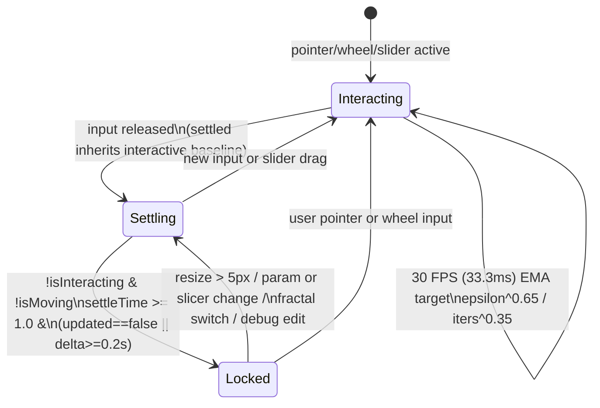

# Adaptive Performance State Machine & Camera Equations

Technical reference for [`src/hooks/usePerformanceAdaptation.ts`](../../../../src/hooks/usePerformanceAdaptation.ts), [`src/hooks/useFractalInteraction.ts`](../../../../src/hooks/useFractalInteraction.ts), [`src/components/FractalCanvas.tsx`](../../../../src/components/FractalCanvas.tsx), and [`src/App.tsx`](../../../../src/App.tsx).

---

## 1. Frame-Loop & Quality State Machine



---

## 2. EMA & Controller Parameters (`usePerformanceAdaptation.ts`)

- **Asymmetric EMA**:
  - `baseWindowSize = isInteracting ? 30 : 15`
  - `effectiveWindowSize = delta > smoothedDelta ? max(2, baseWindowSize / 3) : baseWindowSize` (reacts ~3x faster to frame drops than speedups)
  - `alpha = 1 / min(sampleCount, effectiveWindowSize)`
  - **Lag-spike fast path**: if `delta > smoothedDelta * 1.5 && delta > 0.1`, force `alpha = 0.9`.
- **Update cadence & hysteresis**:
  - Throttled to `>= 66ms` (`~15 Hz`), requires `sampleCount >= 3` (unless `!isInteracting && delta > 0.1`).
  - Target frame time: `33.33ms` (interactive) vs `200ms` (settled).
  - Deadband: `|error| < targetFrameTime * 0.15` returns `false` (converged).
- **Adjustment Gain & Split**:
  - Normal gain/cap: `0.5` / `0.25` (interactive), `0.8` / `0.4` (settled); severe lag (`errorRatio > 2.0`): `gain = 1.0`, `maxAdjustment = min(2.0, errorRatio * 0.5)`.
  - Interactive mode splits by `multiplier^0.65` (epsilon) and `multiplier^0.35` (iterations).
  - Settled mode upgrades symmetrically via `sqrt(multiplier)`, and only downgrades if `multiplier > 2.5` using dampened `pow(splitMultiplier, 0.5)`.

---

## 3. Zoom-LOD Boost & Camera Scaling Equations

- **Iteration Boost (`App.tsx`)**:
  ```ts
  const zoomFactor = Math.max(0, Math.log2(Math.max(1, zoom / defaultZoom)));
  const maxZoomIterBoost = fractalType === 0 ? 6 : 16;
  ```
  Adds up to `floor(zoomFactor * 1.2)` (interactive) and `floor(zoomFactor * 1.8)` (settled), clamped by `config.max*Iterations + maxZoomIterBoost`.
- **Rotation Sensitivity Scaling (`useFractalInteraction.ts`)**:
  ```ts
  zoomRatio <= 1.0
    ? 1.0 / Math.max(0.25, zoomRatio)
    : 1.0 / (1.0 + 0.35 * Math.log2(zoomRatio))
  ```
- **Progressive Zoom Damping (`useFractalInteraction.ts`)**:
  ```ts
  const damping = 1.0 / (1.0 + 0.35 * Math.max(0, Math.log2(Math.max(1, currentZoom / defaultZoom))));
  ```
  Applied 1x when zooming in (`delta > 0`), and `min(1.0, damping * 1.35)` when zooming out. Clamped overall zoom range: `[0.0001, 1000.0]`.
- **Smoothing (`FractalCanvas.tsx`)**:
  - `lerpFactor = 1.0 - Math.exp(-12 * delta)` for zoom (`lerp`), offset (`lerp`), and rotation (`slerp`), snapping when delta falls below `0.0005`.
