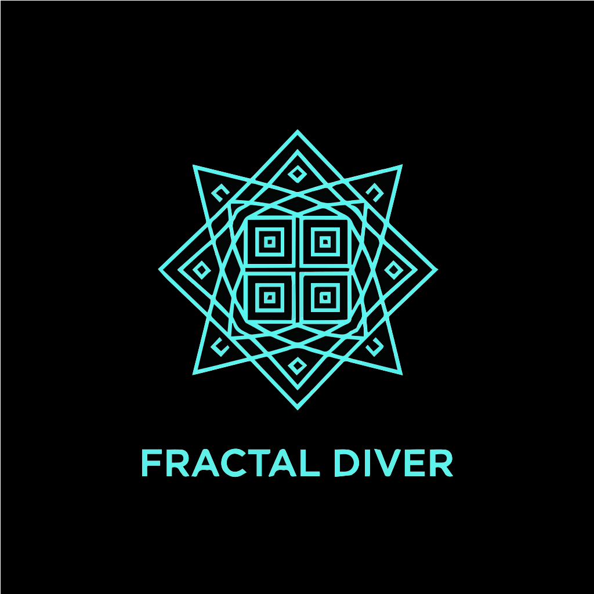

# 🌀 Fractal Diver



> **Dive into the infinite.** A real-time 3D fractal explorer powered by WebGPU and custom WGSL raymarching shaders.

**Live Demo:** [fractal.skorupski.org](https://fractal.skorupski.org)

Fractal Diver lets you fly through six classic three-dimensional fractals in real time right in your browser. Built on **WebGPU** and **Three.js Shading Language (TSL)**, it combines analytic and Iterated Function System (IFS) distance estimators with a closed-loop adaptive performance engine—maintaining fluid camera motion while you explore and progressively refining surface detail the moment you stop. Built with Gemini.

---

**Author:** James Skorupski

## ✨ Features

- **Six Real-Time 3D Fractals**:
  - **Mandelbulb** — Triplex spherical power fractal ($z_{n+1} = z_n^p + c$) with organic canyons and bulbs.
  - **Menger Sponge** — Recursive orthogonal cross-channel IFS with infinitely nested architectural cavities.
  - **3D Julia Set** — Hypercomplex quadratic attractor with live-tunable real and imaginary constants.
  - **Sierpinski Tetrahedron** — Kaleidoscopic IFS (KIFS) folded across tetrahedral symmetry planes.
  - **Mandelbox** — Tom Lowe's box-and-sphere folding fractal combining cubic reflections with spherical inversions.
  - **Apollonian Gasket** — Periodic Kleinian sphere-packing foam.
- **High-Fidelity WebGPU Shading Pipeline**:
  - **Sub-Pixel Cone Clamping**: Bounds raymarching hit thresholds and normal filter kernels by the angular footprint of a screen pixel to eliminate sub-pixel surface aliasing.
  - **4-Tap Tetrahedral Normals**: Evaluates surface gradients in fractal space using Inigo Quilez's 4-sample tetrahedral central-difference stencil.
  - **Hybrid Ambient Occlusion**: Blends multi-sample fractal-space distance occlusion with crevasse step-count shading.
  - **Camera-Relative Studio Lighting & ACES Tonemapping**: Two-point key/fill lighting attached to the camera rig, Blinn-Phong ridge highlights, Fresnel rim glow, orbit-trap color palettes, and ACES filmic tonemapping.
- **Closed-Loop Adaptive Performance**:
  - Uses an asymmetric Exponential Moving Average (EMA) frame-time controller that reacts rapidly to frame drops.
  - Targets **30 FPS** during camera or slider interaction—biasing load-shedding toward raymarching epsilon so 3D fractal geometry stays intact even at deep zoom—and smoothly transitions into high-precision progressive refinement when settled, locking the frame loop once converged to save power.
- **Deep-Zoom Camera Physics & No-Clip Interior Diving**:
  - **Near-Window No-Clip Diving**: Close-up geometry right in front of the camera lens disappears through a near-clipping window while signed fractal interiors are raymarched as double-sided hollow shells with secant zero-crossing refinement—letting you dive seamlessly through outer walls into interior chambers without camera pushback or GPU stalls.
  - Frame-rate independent quaternion SLERP rotation and damped translation.
  - **Progressive Zoom Deceleration**: Automatically scales down zoom increments and rotation sensitivity logarithmically as magnification increases so you can navigate delicate micro-structures without overshooting.
- **Real-Time CSG Slicer & Live Parameters**:
  - Slice cleanly through any fractal along the **X**, **Y**, or **Z** axis using Constructive Solid Geometry (CSG) half-space subtraction to inspect internal chambers.
  - Adjust fractal power, scale, folding radii, Julia constants, and primary/accent color tones in real time.
- **Ultra-HD Wallpaper Export**:
  - One-click offscreen WebGPU capture with 2× supersampling (up to 4K UHD), ACES filmic tone mapping (`SRGBColorSpace`), and high-quality bicubic downsampling.

## 🎮 Controls

| Action | Desktop (Mouse & Keyboard) | Mobile / Touch |
| :--- | :--- | :--- |
| **Orbit / Rotate** | Left-click + drag | 1-finger drag |
| **Pan Camera** | Right-click + drag (or `Shift` + Left-click + drag) | 2-finger drag |
| **Zoom In / Out** | Scroll wheel / trackpad pinch | 2-finger pinch |
| **Slice Interior** | Toggle **Slicer** in bottom toolbar | Toggle **Slicer** in bottom toolbar |
| **Tune Parameters** | Click **Settings** (gear icon) | Tap **Settings** (gear icon) |
| **Save Wallpaper** | Click **Camera** icon | Tap **Camera** icon |
| **Reset View** | Click **Reset** | Tap **Reset** icon |

## 🛠️ Tech Stack & Architecture

- **UI & State**: React 19 + TypeScript + Vite
- **Rendering Engine**: Three.js (`WebGPURenderer` + TSL / WGSL Node Shaders) + React Three Fiber (`demand` frameloop)
- **Styling**: Tailwind CSS v4 + Lucide Icons
- **Testing**: Vitest + React Testing Library + V8 Coverage
- **Deployment**: Cloudflare Workers / Static Assets (`wrangler`)
- **Contributor Docs**: [Architecture Guide](docs/ARCHITECTURE.md) · [Agent Workspace Rules](AGENTS.md)

## 🚀 Getting Started

### Prerequisites

- **Node.js** 20+
- A browser with **WebGPU** support (Chrome 113+, Edge 113+, Firefox Nightly, or Safari 18+).

### Installation & Local Development

1. Clone the repository:
   ```bash
   git clone https://github.com/jskorupski/Fractal-Diver.git
   cd Fractal-Diver
   ```
2. Install dependencies:
   ```bash
   npm install
   ```
3. Start the development server:
   ```bash
   npm run dev
   ```
   Open [http://localhost:3000](http://localhost:3000) in a WebGPU-capable browser.

## 🧪 Scripts & Testing

- `npm test` — Run the unit test suite via Vitest.
- `npx vitest run --coverage` — Run unit tests with V8 code coverage report.
- `npm run lint` — Type-check the project with TypeScript (`tsc --noEmit`).
- `npm run build` — Build the production bundle into `dist/`.
- `npm run preview` — Build and preview locally via Cloudflare Wrangler.

## 📄 License

This project is licensed under the Apache-2.0 License.
