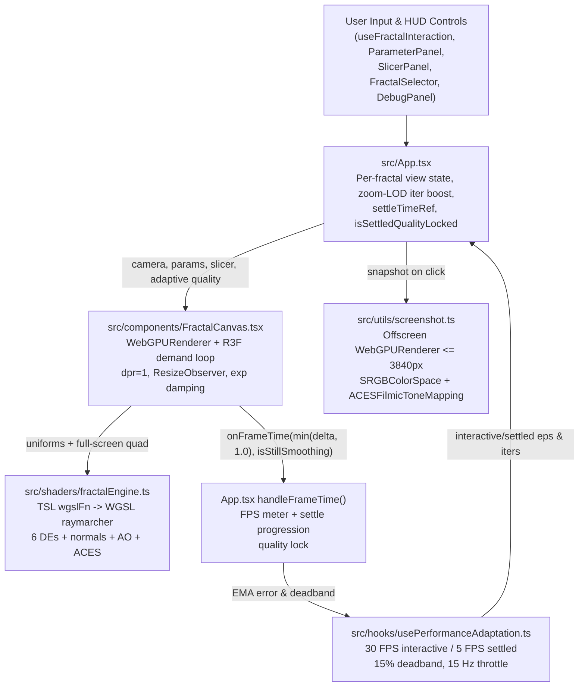

# Fractal Diver — System Architecture

This document details the runtime data flow, coordinate transforms, WGSL raymarching pipeline, closed-loop adaptive quality controller, and testing architecture of **Fractal Diver**.

---

## 1. High-Level System Topology

---

## 2. Coordinate Spaces & Raymarching Pipeline (`src/shaders/fractalEngine.ts`)

### Camera & Fractal Space Transform
1. **Screen Coordinates**: Pixel UVs `vUv` in `[0, 1]^2` are centered and aspect-corrected:
   $$\text{uvCoords} = (\text{vUv} - 0.5) \cdot \left(\frac{W}{H}, 1\right)$$
2. **World-Space No-Clip Rig**:
   - `rayOrigin = uniformRotation * vec3(0.0, 0.0, -5.0) + uniformOffset`
   - `rayDirection = uniformRotation * normalize(vec3(uvCoords, 1.5))`
   Because the orbit radius is `5.0`, the pivot at `totalDist = 5.0` sits directly on `uniformOffset`. No geometry-avoidance probe alters `rayOrigin`, eliminating camera pistoning during rotation.
3. **Global Fractal Space**: Each march sample `currentPoint = rayOrigin + rayDirection * totalDist` transforms into fractal space around `uniformOffset`:
   $$\text{globalPoint} = \frac{\text{currentPoint} - \text{uniformOffset}}{\text{uniformZoom}} + \text{uniformOffset}$$
   World-space distance is recovered via `signedDist = data.x * uniformZoom`.

### Near-Clipping Window & Hollow-Shell Interior Diving
- **Near-Clip Window**: Rays start at `totalDist = 0.40`. When the CSG slicer is disabled (`uniformSlicerEnabled < 0.5`), surface hits closer than `totalDist < 0.55` advance forward (`+max(0.05, dist)`) instead of terminating, creating an unobstructed window right in front of the lens as you dive inside a fractal.
- **Hollow-Shell Marching**: When unsliced, the loop marches with `dist = abs(signedDist)` and triggers secant root interpolation whenever `prevSigned * signedDist < 0.0` (with `abs(prevSigned) < 0.2 * uniformZoom`). Combined with `safeR = select(radius, max(0.25, radius), radius < 1.0)` in Mandelbulb and Julia, rays cross solid interiors in ~10–40 steps rather than stalling.
- **Sub-Pixel Cone Clamping**:
  - `pixelScale = 1.0 / max(300.0, resolution.y * 1.5)`
  - `effectiveEpsilon = max(pixelScale * 0.35, mix(uniformInteractiveEpsilon, uniformSettledEpsilon, uniformSettleTime))`
  - `threshold = max(0.0000005, effectiveEpsilon * totalDist)`
  Bounding epsilon by the pixel's angular footprint prevents wasting steps resolving sub-pixel fractal dust.

### Normals, Lighting, & Post-Processing
- **4-Tap Tetrahedral Gradient**: Evaluates 4 SDF offsets `k1..k4` at fractal-space kernel `normalEpsilon = max(0.000005, max(threshold * 2.5, pixelScale * totalDist * 0.75) / uniformZoom)`. When diving inside hollow shells, `orientedNormal` flips the unit normal toward `-rayDirection` so inner walls shade accurately.
- **Hybrid AO**: Blends 1–3 distance-AO taps (`distAO`, dynamically reduced when `stepCount > 120` or `> 250`, active when `uniformInteracting < 0.5 && uniformSettleTime > 0.01`) with crevasse `stepAO = mix(0.15, 1.0, exp(-f32(stepCount) * 0.012))`.
- **Lighting & Color**: Camera-attached key light `(0.8, 1.2, -0.8)` and fill light `(-0.6, -0.2, -0.5)` (`diffuse <= 1.0`), Blinn-Phong specular (`pow(NdotH, 32) * 0.12`), Fresnel rim (`0.15 * (1 - NdotV)^4`), orbit-trap palette mixing (`uniformBaseColor` -> `uniformAccentColor` + `6%` smooth cosine spatial variation), ACES Filmic tonemapping, and zoom-normalized depth fog (`fogDist = totalDist / max(1.0, pow(uniformZoom, 0.8))`).

---

## 3. Fractal Catalog & Parameter Mapping (`src/constants/fractals.ts`)

`uniformParameters` packs `(qualityOffset, param1, param2, param3)` into `(x, y, z, w)`:

| ID | Fractal | WGSL Function | DE Type | `param1` (`y`) | `param2` (`z`) | `param3` (`w`) | Default Zoom | Slicer Default | Iteration Bounds (Int / Set) |
| :-: | :--- | :--- | :--- | :--- | :--- | :--- | :-: | :-: | :--- |
| `0` | **Mandelbulb** | `getMandelbulbData` | Triplex analytic (signed) | Power (`8.0`) | — | — | `1.2` | Off | `6–12` / `8–14` (`+6` zoom cap) |
| `1` | **Menger Sponge** | `getMengerSpongeData` | Recursive box fold (signed) | Scale (`3.48`) | — | — | `1.0` | Off | `4–16` / `8–48` (`+16` zoom cap) |
| `2` | **Julia Set** | `getJuliaData` | 3D hypercomplex quadratic (signed) | — | C Real (`-0.8`) | C Imag (`0.156`) | `1.2` | On (Z=0) | `24–80` / `24–150` (`+16` zoom cap) |
| `3` | **Sierpinski** | `getSierpinskiData` | Tetrahedral KIFS (unsigned) | Scale (`1.75`) | — | — | `1.0` | Off | `8–30` / `15–48` (`+16` zoom cap) |
| `4` | **Mandelbox** | `getMandelboxData` | Box + sphere fold (unsigned) | Scale (`2.0`) | Min Radius (`0.135`) | Fixed Radius (`1.0`) | `0.15` | Off | `16–48` / `24–120` (`+16` zoom cap) |
| `5` | **Apollonian** | `getApollonianData` | Periodic Kleinian inversion (unsigned) | Scale (`1.0`) | — | — | `1.5` | On (Z=0) | `4–24` / `8–32` (`+16` zoom cap) |

---

## 4. Adaptive Performance & Demand-Loop Lifecycle

1. **Interactive Mode (`activeInteracting = isInteracting || isDragging`)**:
   - `settleTimeRef.current = 0`.
   - `usePerformanceAdaptation` targets **30 FPS (`33.3ms`)** via an asymmetric EMA (window `30` when improving, `~10` when lagging, instant `alpha = 0.9` if `delta > 1.5 * avg && delta > 0.1s`).
   - Load shedding biases toward `epsilon` (`multiplier^0.65`) over `iterations` (`multiplier^0.35`) so deep-zoom 3D topology stays intact during drags.
2. **Settling & Progressive Refinement**:
   - On release, settled quality inherits `interactiveEpsilon` and `interactiveIterations` immediately so there is no spike on the first idle frame.
   - `settleTimeRef` ramps toward `1.0` (`+delta * 2.5`), smoothly blending interactive and settled shader uniforms while targeting **5 FPS (`200ms`)**.
   - Meanwhile, `FractalMesh` damps `smoothedZoom`, `smoothedOffset`, and `smoothedRotation` toward targets with `1 - exp(-12 * delta)`.
3. **Idle Lock (`isSettledQualityLocked`)**:
   - Once `!activeInteracting`, `settleTime >= 1.0`, `!isActuallyMoving`, and either `onFrameTime(...) === false` (converged / ceiling hit) or `delta >= 0.2s` (5 FPS budget reached), `App.tsx` sets `isSettledQualityLocked = true` and stops calling `invalidate()` — dropping GPU utilization to **0%** until input, resize, or parameter changes occur.

---

## 5. Verification Strategy

- **Unit & Integration Tests (`npm test`)**: Runs Vitest 4 under `happy-dom` across 10 suites covering constants, performance adaptation math, R3F canvas resize/device-loss handling, UI controls, ACES wallpaper export, and full app state.
- **Zero-Drift CPU WGSL Testing (`src/shaders/fractalEngine.test.ts`)**: Extracts live `(renderFractal as any).functionNode.code` directly from Three.js TSL, transpiles WGSL expressions via a Pratt parser (`compileWGSLModule`) onto a JS `Vec`/`mat3x3` math runtime, and executes `get*Data`, `getFractalData`, and `renderFractal` on CPU in ~50 ms.
